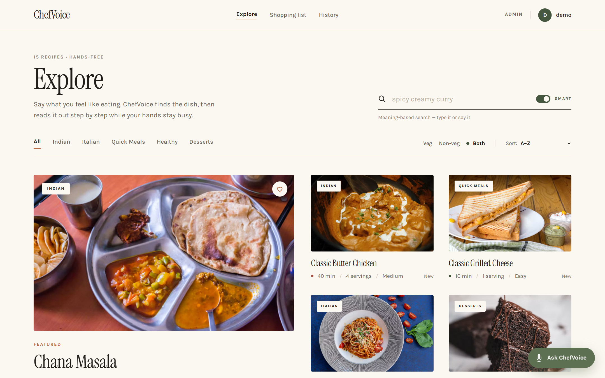
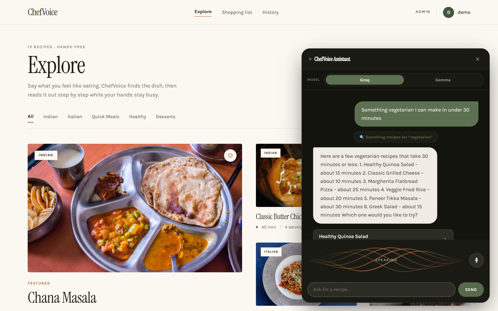
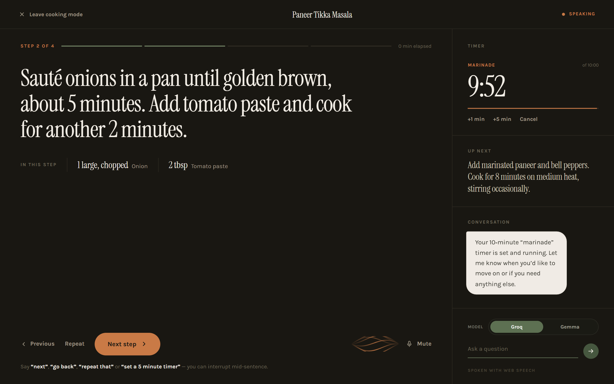
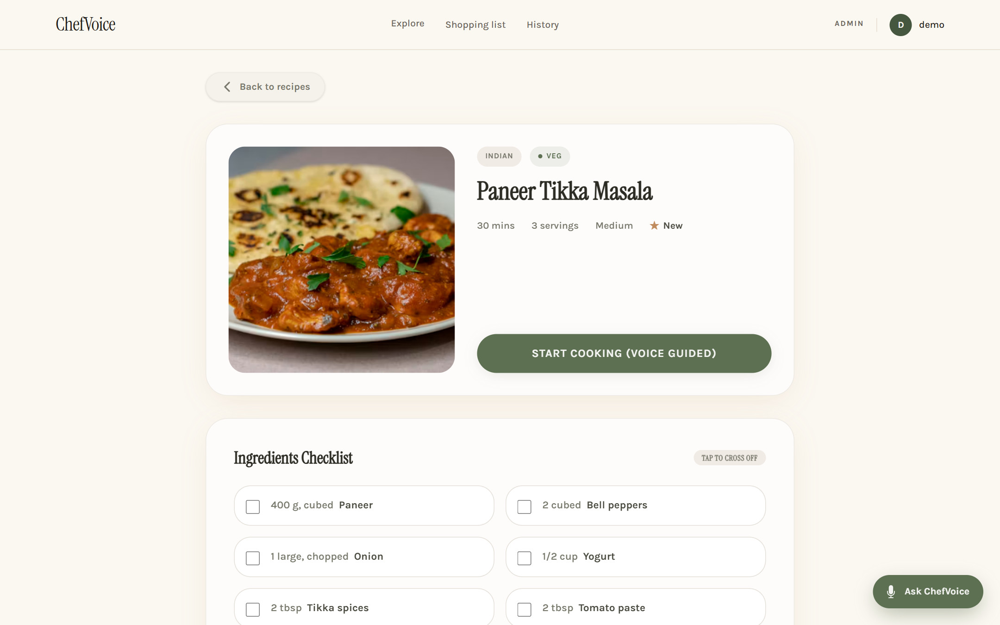
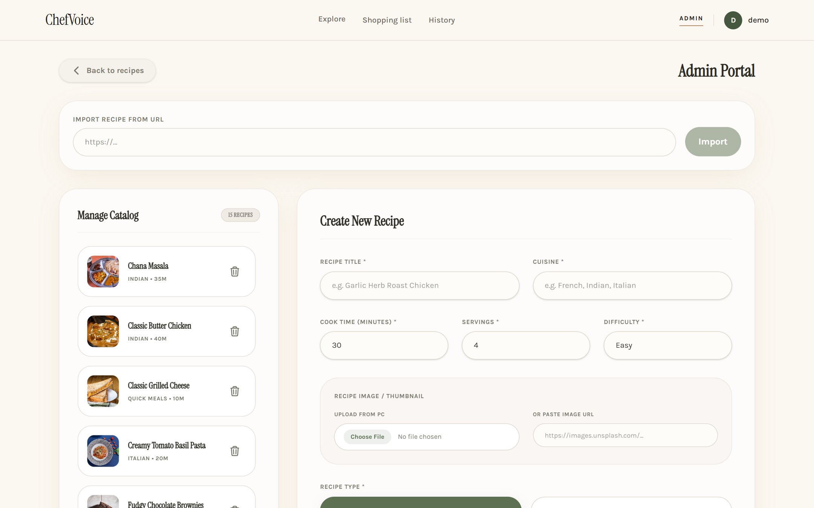

# ChefVoice App



A voice-first AI cooking assistant with real-time audio streaming, semantic recipe search, and a conversational web UI.

Navigate cooking steps hands-free, set smart timers, ask questions about ingredients, and receive high-fidelity spoken guidance — all powered by a streaming AI architecture. Data lives in a single SQLite file, authentication is self-hosted, and recipe search runs in-process — the only cloud calls are speech-to-text (Deepgram) and the LLM (Groq), and the LLM can be swapped for a fully local model.

---

## Features

| Feature | Description |
| --- | --- |
| **Hands-Free Navigation** | Navigate through recipe steps completely hands-free using natural language commands like "next step" or "what was the first step?". |
| **Barge-In Capabilities** | The assistant is truly conversational. Interrupt the AI mid-sentence and it will instantly stop talking and listen to your new command. |
| **Spoken Responses** | The browser Web Speech API voices the assistant's replies — instant, and no cloud TTS key required. |
| **Hybrid Search (RAG)** | Dense retrieval (`all-MiniLM-L6-v2` embeddings, cosine similarity over a cached NumPy matrix) fused with lexical BM25 (SQLite FTS5) via Reciprocal Rank Fusion, with synonym expansion, metadata pre-filtering (diet, cook time), and score thresholds — type "spicy creamy curry" and get the right dishes even without keyword matches. Measured against a golden set in `backend/eval/`. |
| **Tool-Calling Agent** | A multi-round tool-calling loop over 10 server-side tools — recipe search, recipe details and selection, starting a cooking session, step navigation, current step, timers (set/cancel), cooking history, and URL import. The tool set is scoped to the current screen (6 on home, 4 while cooking) so the model only sees tools that make sense right now. |
| **Selectable LLM** | Pick the model from the assistant's model selector: **GPT-OSS 120B** on Groq (fast, default, with automatic fallback to GPT-OSS 20B on timeouts), or a fully **local Gemma 4 26B** served by [Ollama](https://ollama.com/) — no API key, runs on your own machine, and auto-splits across VRAM + RAM when it doesn't fit the GPU. Groq is OpenAI-compatible; the local option speaks Ollama's native API (so its reasoning phase can be switched off for snappy replies), and the agent loop handles both. |
| **Shopping List** | A per-user shopping list panel — add, check off, and remove items, persisted in SQLite. |
| **Recipe Import** | Paste a recipe URL (or ask by voice); the agent scrapes the page, extracts structured recipe JSON, embeds it, and adds it to the catalogue. |
| **Speech-to-Text Input** | Deepgram `nova-2` streaming API provides sub-second, highly accurate transcription of continuous audio streams. |
| **Intelligent Timers** | Context-aware timer management (e.g., "set a timer for the pasta"). Timers are fully controllable via voice. |
| **Local Auth & Profiles** | Self-hosted JWT authentication (bcrypt-hashed passwords). Favorites, cooking history, ratings, and an admin recipe portal are all scoped per user. |

---

## Screenshots

| | |
| --- | --- |
|  **Assistant** — the agent calls its search tool (shown as a chip), speaks the answer, and attaches the matching recipes. |  **Cooking mode** — hands-free steps, a voice-set named timer, and the conversation alongside. |
|  **Recipe detail** — ingredients checklist and one-tap voice-guided cooking. |  **Admin portal** — create recipes or import one from a URL; new recipes are embedded and searchable immediately. |

---

## Getting Started

### Prerequisites
* Python 3.10+ (tested on 3.11 and 3.13)
* Node.js 20.19+ or 22.12+ and npm (required by Vite 8)
* API keys for the voice pipeline (optional — everything except the live voice assistant works without them):
  [Deepgram](https://deepgram.com/) (speech-to-text) and [Groq](https://console.groq.com/) (the default tool-calling agent).
  Text-to-speech uses the browser, so no TTS key is needed.
* **Optional — local LLM:** to use the on-device **Gemma** option, install [Ollama](https://ollama.com/) and import your GGUF once (no API key needed):
  ```bash
  ollama create chefvoice-gemma -f backend/Modelfile.gemma   # edit the FROM path to your .gguf
  ```
  Keep `ollama serve` running and pick **Gemma** in the model selector. A 26B model won't fully fit a 12 GB GPU, so Ollama offloads the overflow layers to system RAM automatically.

There is **no database server to install** — the app creates a local SQLite file on first run.

On a fresh machine, expect the Python install to download about 1 GB (mostly PyTorch) and the first run to download the `all-MiniLM-L6-v2` embedding model (~90 MB). API keys live only in `backend/.env`, which is not committed, so bring your own keys or a copy of your `.env`.

### Local Development

1. **Clone the repository**
   ```bash
   git clone https://github.com/kirithic-0/chef-voice.git
   cd chef-voice
   ```

2. **Install and run the backend**
   ```bash
   cd backend
   python -m venv .venv

   # Activate virtual environment
   # Windows: .venv\Scripts\activate
   # macOS/Linux: source .venv/bin/activate

   pip install -r requirements.txt

   # Configure environment (copy the example and fill in your keys + a JWT secret)
   cp .env.example .env

   # Create the SQLite database and generate recipe embeddings (run once)
   python seed.py

   # Start the FastAPI dev server on http://localhost:8000
   uvicorn main:app --reload
   ```

3. **Install and run the frontend (separate terminal)**
   ```bash
   cd frontend

   # Install Node dependencies
   npm install

   # Start the Vite dev server
   npm run dev
   ```

4. **Open in browser**
   Navigate to the URL provided by Vite (usually `http://localhost:5173`).
   Create an account with any username and password (stored locally in your SQLite database) and start cooking.

> **Tip:** To use the admin recipe portal, open **My Profile** and toggle **Admin Mode**.

---

## Environment Variables

**Backend (`backend/.env`)** — copy from `backend/.env.example`
| Variable | Required | Description |
| --- | --- | --- |
| `DEEPGRAM_API_KEY` | Voice only | Deepgram API key for real-time speech-to-text |
| `GROQ_API_KEY` | Voice only | Groq API key for the default GPT-OSS agent ([console.groq.com/keys](https://console.groq.com/keys)) |
| `GROQ_MODEL` | Optional | Override the Groq model (default `openai/gpt-oss-120b`) |
| `LOCAL_LLM_MODEL` | Optional | Ollama model name for the "Gemma" local option (default `chefvoice-gemma`) |
| `LOCAL_LLM_BASE_URL` | Optional | Ollama native chat endpoint (default `http://localhost:11434/api/chat`) |
| `OLLAMA_KEEP_ALIVE` | Optional | How long Ollama keeps the local model warm between turns (default `30m`) |
| `DEFAULT_MODEL_PROVIDER` | Optional | Provider used when the client sends none: `llama` (Groq, default) or `local` |
| `JWT_SECRET` | Recommended | Secret for signing session tokens (use a long random string in production) |
| `FRONTEND_ORIGIN` | Optional | Comma-separated allowed CORS origins (default `http://localhost:5173,http://127.0.0.1:5173`) |
| `CHEFVOICE_DB` | Optional | Path to the SQLite file (default `backend/chefvoice.db`) |

**Frontend (`frontend/.env`)** — optional, copy from `frontend/.env.example`
| Variable | Description |
| --- | --- |
| `VITE_API_BASE_URL` | Backend base URL (default `http://localhost:8000`). The WebSocket URL is derived automatically. |

---

## Architecture Overview

### Tech Stack

#### Backend
| Technology | Purpose |
| --- | --- |
| **Python 3.10+** | Runtime language |
| **FastAPI** | Async web framework with robust WebSocket support |
| **SQLite** | Zero-config, single-file relational database |
| **Sentence-Transformers** | Local embedding generation (`all-MiniLM-L6-v2`) |
| **NumPy + SQLite FTS5** | In-process hybrid search: cosine-similarity vectors fused with BM25 keyword ranking |
| **PyJWT + bcrypt** | Self-hosted JWT authentication with hashed passwords |
| **Deepgram** | Streaming Speech-to-Text (ASR) engine |
| **Groq / Ollama** | Selectable tool-calling LLM: GPT-OSS 120B on Groq over the OpenAI-compatible API, or a local Gemma 4 26B over Ollama's native API |

#### Frontend
| Technology | Purpose |
| --- | --- |
| **React 19** | UI framework |
| **Vite** | Build tool and dev server |
| **Tailwind CSS 4** | Utility-first CSS styling and responsive design |
| **Web Audio API** | Low-latency audio capture and custom waveform visualization |
| **Web Speech API** | Fallback client-side speech synthesis |

### Data Layer
All persistence lives in a single SQLite file (`backend/chefvoice.db`) with tables for
`users`, `profiles`, `recipes`, `favorites`, `cooking_history`, `conversations`, and
`shopping_list_items`, plus the `recipes_fts` full-text index.
List/array fields are stored as JSON text and the 384-dimension embeddings as float32 BLOBs. Search
(`retrieval.py`) keeps the embeddings in memory as one normalized matrix and fuses its
cosine-similarity ranking with an FTS5 BM25 keyword index — no external vector database required. Per-user data isolation is enforced in the API
layer by scoping every query to the authenticated user id from the JWT.

---

## API Reference

### Authentication — `/auth`
| Endpoint | Method | Description |
| --- | --- | --- |
| `/auth/signup` | `POST` | Create an account (`username`, `password`); returns a JWT |
| `/auth/login` | `POST` | Sign in; returns a JWT |
| `/auth/user` | `GET` | Return the authenticated user (validates the token) |

### WebSocket — `/ws/chat?token=<jwt>`
Real-time conversational voice interaction, streaming audio in and out.

* **Client → Server**: Client streams raw microphone audio captured via the Web Audio API, plus JSON control frames for cooking-state sync and text input.
* **Server → Client**: Server transcribes the audio, runs the Groq tool-calling agent, and streams back the agent's text tokens plus structured tool/UI events (timers, step navigation, shopping-list updates, etc.). The browser speaks the final reply with the Web Speech API.

### REST — Recipes, Profile, Favorites, History
All REST endpoints require an `Authorization: Bearer <jwt>` header.

| Endpoint | Method | Description |
| --- | --- | --- |
| `/providers` | `GET` | List the LLM providers and whether each is configured/reachable (drives the model selector) |
| `/recipes` | `GET` | Fetch all recipes |
| `/recipes/search?query=...` | `GET` | Semantic vector search |
| `/recipes/{id}` | `GET` | Fetch a specific recipe |
| `/recipes` | `POST` | Create a recipe (admin only; embedding generated server-side) |
| `/recipes/{id}` | `DELETE` | Delete a recipe (admin only) |
| `/profile` | `GET` | Get the current user's profile |
| `/profile/admin` | `PUT` | Toggle the current user's admin flag |
| `/favorites` | `GET` / `POST` | List or add favorites |
| `/favorites/{recipe_id}` | `DELETE` | Remove a favorite |
| `/history` | `GET` / `POST` | List or log completed cooking sessions (with rating) |
| `/conversations` | `GET` / `POST` | Fetch or save voice-session transcripts |
| `/shopping-list` | `GET` / `POST` | List or add shopping-list items |
| `/shopping-list/{id}` | `PATCH` / `DELETE` | Update or remove a shopping-list item |
| `/recipes/import` | `POST` | Import a recipe from a URL (the agent scrapes, extracts, and embeds it) |

---

## Testing

Backend tests use `pytest` and run against a temporary SQLite database.

```bash
cd backend
pytest -v
```

Frontend API-client tests use `vitest`.

```bash
cd frontend
npm test
```

Test coverage includes:
* Recipe fetching and structure validation
* Hybrid retrieval precision, filtering, and thresholds (`test_retrieval.py`)
* The tool-calling agent loop and its 15 tools (`test_agent.py`, `test_tools.py`)
* Authentication and per-user authorization (`test_backend.py`, `test_authz.py`)
* 404 handling for unknown recipes

Retrieval quality can also be scored against a golden query set:

```bash
cd backend
python eval/evaluate.py
```
